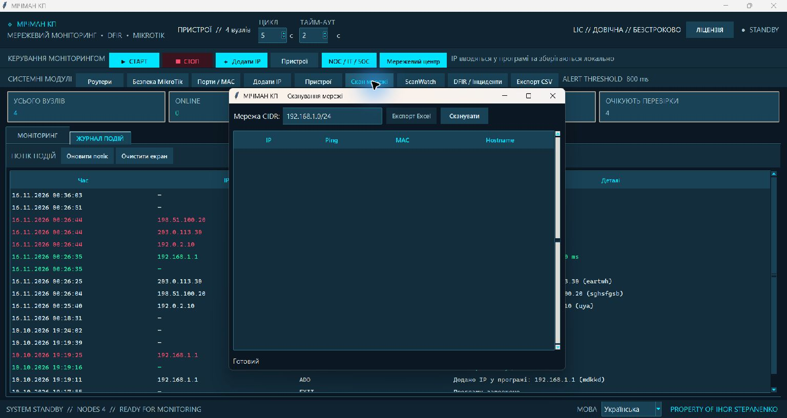
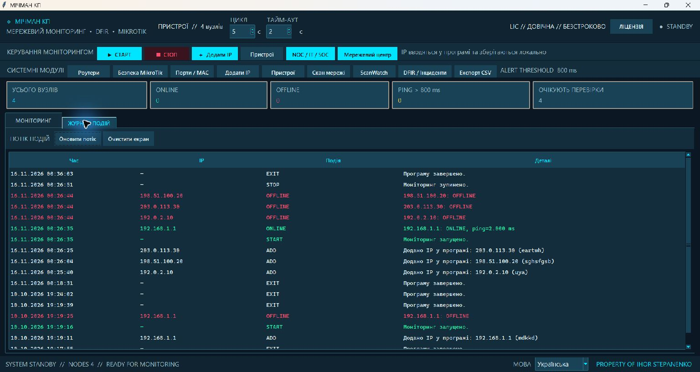
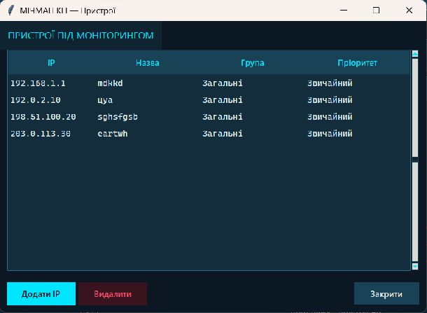

# MICHMAN

MICHMAN is a Windows network and managed-PC administration suite. This repository contains the source packages and release files supplied for MICHMAN KP 2.6.0 and MICHMAN Agent 2.2.0.

## Releases

### MICHMAN KP 2.6.0

- Installer: `releases/2.6.0/MichmanKP_Setup_2.6.0.exe`
- Windows x64 package: `releases/2.6.0/MichmanKP_2.6.0_Windows_x64.zip`
- Source package: `source/MichmanKP_2.6.0_Source.zip`
- Release notes: `releases/МІЧМАН_2.6.0_Стан_ПК.md`
- SHA-256 checksums: `releases/MichmanKP_2.6.0_SHA256.txt`

Version 2.6.0 adds read-only managed-PC health, hardware, network-adapter and agent-diagnostics views. These features require MICHMAN Agent 2.2.0.

## MICHMAN KP overview

MICHMAN KP monitors configured network nodes and groups related network-administration tools in one desktop application.

- **Monitoring:** Displays each node's IP address, name, online state, response time, packet loss, check counts, and last check. The dashboard summarizes online, offline, and pending nodes.
- **Event log:** Records monitoring starts and stops, node additions, and online/offline transitions with timestamps and details.
- **Device list:** Shows configured nodes with their names, groups, and priorities, and provides controls for managing the list.
- **Network scan:** Accepts a CIDR range and presents discovered IP, ping, MAC, and hostname fields. Scanning is user-initiated.
- **Ports / MAC:** Offers TCP port checks for a selected IP and related MAC details where available.
- **MikroTik security:** Provides MikroTik security tools after a device and its access credentials have been configured.
- **ScanWatch:** Displays detected port-scan activity from Windows Firewall logs and provides response controls. Firewall log access depends on Windows permissions.
- **DFIR / Incident Response:** Organizes incident records, remote collection, timeline, and evidence views.
- **CSV export:** Exports monitoring data for reporting.

### Screenshots

The screenshots below show the main monitoring view, event history, and configured device list.

#### Monitoring dashboard



The dashboard summarizes node counts and shows each configured IP address, its display name, status, ping, loss, check counts, and last check. Monitoring can be started and stopped from the controls above the table.

#### Event log



The event log records monitoring start and stop events, program exits, node additions, and online/offline changes with timestamps and details.

#### Device list



The device list shows each monitored address, its friendly name, group, and priority. It also provides controls to add or remove entries.

### Other sections

- **Network scan:** Enter a CIDR range to discover hosts and view IP, ping, MAC, and hostname results.
- **Ports / MAC:** Select a node to inspect TCP ports and available MAC details.
- **MikroTik security and router tools:** Configure a MikroTik device first; available actions depend on the device and supplied credentials.
- **ScanWatch:** Review detected port scanning and firewall log events. Windows permissions affect access to firewall logs.
- **DFIR / Incident Response:** The workspace has Incidents, Remote collection, Timeline, and Evidence subsections.
- **CSV export:** Export monitoring information for use in reports.

The screenshots show the interface with the current local configuration. Discovery, port checks, router actions, and remote collection require their respective network settings and permissions.

## Temporary license

Temporary license valid for 24 hours: `FO56-hF8t-TEwq-2424`

For license renewal or purchase, contact `bariga.test@gmail.com` or Telegram `@SUN_FACE1`.

## Crypto donations

The following addresses are provided for voluntary project support. Select the matching network when sending funds.

| Asset | Network | Address |
| --- | --- | --- |
| ETH | Ethereum | `0x51262c31651227268D9876416C396acDfF49dB0a` |
| BTC | Bitcoin | `bc1qnn65zepn7k09rcempdru4y9qfvp80cp0p6qae3` |
| USDT | TRON (TRC-20) | `TN2QLGS2ys5pVioZ7wkPiGTxcZekDEypvv` |

### MICHMAN Agent 2.2.0

MICHMAN Agent provides authenticated access to managed PCs for monitoring and remote assistance. It supports Windows and Linux deployments; the Windows installer registers the agent to start for the current user.

#### Security and encrypted communication

- **Mutual TLS (mTLS):** Agent and console authenticate each other with certificates over the existing mTLS channel. Agent data is available only to an authenticated operator through this channel.
- **Individual registration:** Install the agent using the per-device registration package generated in the console.
- **Read-only system modules:** `health`, `hardware`, `network_info`, and `agent_diagnostics` report system health, hardware, network adapters, and agent status. They do not run arbitrary commands or change Windows/Linux configuration.
- **Remote assistance consent:** The user is asked to approve a Remote Assistance session before it starts. Remote assistance includes screen streaming and keyboard/mouse input.
- **Transfer and diagnostics:** The agent supports verified multi-file transfer. Diagnostics include mTLS status, port, active sessions and transfers, log size, and certificate expiry. Fleet status reports omit passwords and private keys.

The encryption and authentication details above describe the documented agent-to-console mTLS channel. Review the agent instructions and release notes for setup requirements and the exact scope of each feature.

- Windows installer: `releases/agent-2.2.0/MICHMAN_Agent_Setup_2.2.0.exe`
- Windows x64 package: `releases/agent-2.2.0/MICHMAN_Agent_2.2.0_Windows_x64.zip`
- Linux source package: `source/MICHMAN_Agent_2.2.0_Linux_Source.zip`
- Instructions: `releases/МІЧМАН_Agent_2.2.0_Інструкція.md`
- SHA-256 checksums: `releases/MICHMAN_Agent_2.2.0_SHA256.txt`

## Verify downloads

Compare a downloaded file's SHA-256 digest with the corresponding entry in the checksum text file. On Windows, run:

```powershell
Get-FileHash .\MichmanKP_Setup_2.6.0.exe -Algorithm SHA256
```

## Source and license

The supplied source archives include their own documentation and license files. Review the applicable license in each source package before using, modifying, or redistributing the software. The Windows installers and binaries are provided as release artifacts.

## Repository contents

This repository is assembled from the release folder supplied by the project maintainer. It does not include customer configuration, activation data, credentials, or private keys.
